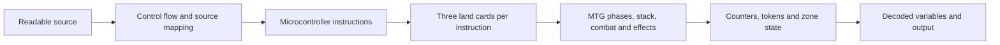

# Readable programs running through Magic

This is the initial architecture sketch. The [current project plan](http://localhost:8313/yoss/Projects/MTGComputer/Plan) owns implementation ordering and acceptance; the [visual debugger specification](visual-debugger.md) describes the linked source/program/board/event interface.

## Architecture decision

Prefer a compiler targeting the 2024 microcontroller, conditional on accepting a larger legal deck. Its arithmetic and memory operations remove the old binary-TM/tag-system/UTM interpreter cascade. A Rust rewrite of that cascade alone would improve simulation speed on the host computer, but would not reduce the number of Magic turns.

Exactly 60 cards remains an unanswered preference. If it is required, the published 360-card construction does not satisfy it. The meaningful alternatives are a proved reduced microcontroller supporting a smaller instruction subset, or the original 60-card UTM with a compiler that reduces its actual work. Neither reduced deck nor improved original compiler is established by this starter.

## Layers to expose

Today the Rust implementation executes C and preserves links to A and D. E is a future independent execution backend. It must derive F from legal Magic transitions, then decode it and compare with C. It must not call the ISA operation, mutate counters directly, and describe the result as rules verification.

The initial readable language uses named natural-number variables, assignment, arithmetic, labels, conditional branches and halt. The compiler maps names to registers, uses base-144 NumBuild chains for arbitrary constants, relocates labels after branch expansion, and handles the special opcode meaning `5 Y Y = Zero`. A future structured frontend can introduce expressions, while loops and functions above the same backend; a general Rust-to-MTG compiler is outside this investigation.

## Trace and viewer contract

Current JSON Lines frames contain step, current/next instruction address, source line, three numeric symbols, three land names, instruction description, all twelve registers before/after as decimal strings, flag before/after and halt state.

The MTG backend needs finer events: active player/phase, permanent or card IDs, generated ability instances, legal targets, stack pushes/resolutions, phasing, zone movement, power/toughness derivation, counter changes and state-based actions. Each event must link back to the instruction and source statement. Keep physical-card identity separate from game-object identity: a zone change normally creates a new game object; phasing follows different rules.

A debugger should have separate step sizes: source statement, microcontroller instruction, turn/phase and individual rules event. A selected source statement highlights its generated instruction range, program land cards and participating permanents. Show registers as both decoded integers and actual modified Joraga Warcaller permanents with counters. For memory, expose the Mouse's base stats, address counters and resulting stats; displaying only its final power obscures the encoding.

This visual debugger should consume execution traces. It should not own simulation semantics. Replay backward using checkpoints and events; do not invent reverse Magic actions. Symbolic fast-forwarding can accelerate inspection, but must be visibly distinguished from replaying every Magic event.

## Next implementation milestones

1. **Freeze the target construction.** Snapshot rules, current Oracle text, selected instruction recipes, creature-type assignments, modifications and timestamps. Reconcile the full manuscript with live corrections. Replace Cephalid with a valid unused type and check collisions. Emit a construction manifest with provenance.
2. **Build an independent source evaluator.** Execute parsed source directly and compare decoded values at source boundaries with compiled ISA execution. Current mathematical golden tests and author-interpreter comparisons provide a useful initial check, not this full proof.
3. **Verify Add and Add1 first.** Model active Joraga Warcaller power contribution, Halana and Alena's mandatory combat trigger, targeting protections and gates. For every reachable state, determine all legal targets and trigger orders, and confirm decoded counters match arithmetic. Include zero values, equal operands and phased gates.
4. **Model the real program reader.** Vaevictis, the library queue, Wheel of Sun and Moon and three Alice combats must actually read X/Y/Z and activate the correct gates. Register mutation without this mechanism does not demonstrate program execution.
5. **Verify constant build, copy, conditional decrement, branch and halt.** These are sufficient for the sum program. Register updates, wither/counter cancellation, flag zones, jump library movement and Celestial Convergence outcomes need their own rules derivations.
6. **Run a full bounded program through the board backend.** Compare ISA and decoded board state after each instruction, retain all MTG events, and audit every reachable outcome-changing choice. Sum from ten to zero is a practical first loop; use a smaller constant for a tabletop demonstration.
7. **Prepare a physical setup.** Generate deck counts, inventories for both players, tokens, copiable versus noncopiable modifications, timestamp ordering, setup actions, expected board state and a printable execution transcript. Check current format legality and count support cards separately from program cards. Setup may involve choices, as it did in the original paper; runtime must meet the selected forced profile.
8. **Add the viewer over this verified trace.** Source and instruction stepping can be demonstrated earlier, but advertise MTG stepping only when real board events exist.

Each milestone has its own acceptance evidence. Do not mark physical demonstration prepared until the complete setup can be legally reproduced.

## If 60 cards is required

First count the dependency closure for only the needed instructions. The 2024 paper says unused instruction machinery may be omitted, but does not prove that the selected subset fits 60 cards. Program land cards themselves take three slots per instruction, so program length directly consumes the deck budget. Cards copied into multiple modified permanents during setup count by deck copies, not final permanent count.

If that reduction fails, keep the original fixed UTM and focus on actual compilation overhead:

- Compile suitable arithmetic directly to a small tag system instead of generating an arbitrary TM and then binarizing it.
- Minimize the tag alphabet and production lengths before Rogozhin encoding; measure tape tokens and executed UTM transitions rather than host runtime alone.
- For small programs, investigate a specialized transition table that uses the original infrastructure, with a legal setup recipe and transition/permanent count. This is a candidate alternative, not an automatic way to keep any arbitrary TM within 60 cards.
- Preserve a decoder and source annotations for the tag word and UTM tape. Measure each layer's step expansion so conversion work has a visible objective.

Benchmark equivalent computations under both representations: source steps, instruction/tag/UTM steps, Alice and Bob turns separately, maximum token/permanent count, maximum counters and deck cards. Do not equate one original UTM transition with one high-level arithmetic instruction. Unbounded mathematical memory describes potential resource growth, not a claim that a physical table can hold infinitely many objects.
