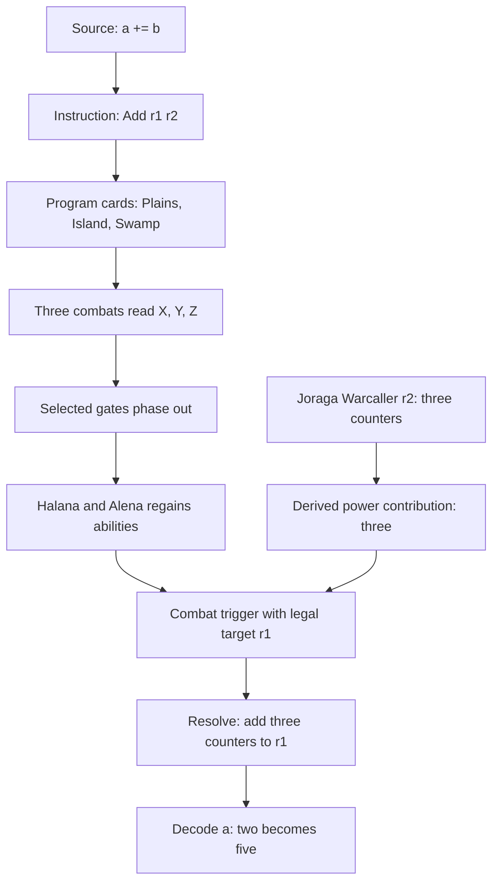

# Visual debugger specification

Product target, 2026-10-10. An initial offline checkpoint viewer is implemented in `web/replay.html` and exported by `cargo run -- replay TRACE OUTPUT.html`. It shows source, instructions, cyclic queue, actual effective cards and counters, events, causal parent links and provenance. Browser checks pass on the partial recorded game. The complete behavior and acceptance checks below are still targets; layer derivation, exact event-state replay, choice branches and complete-run navigation remain open.

## Default view

Show four linked areas rather than an undifferentiated field of hundreds of permanents:

| Area | Contents | Selection behavior |
| --- | --- | --- |
| Source | Readable program, current statement and named inputs/results. | Select a statement to reveal its compiled instruction range and participating cards. |
| Program | Decoded instruction list, three land symbols, a cyclic library ribbon, and X/Y/Z latch state. | Select an instruction to show which gates enable it and which source statement produced it. |
| Battlefield | Alice and Bob's relevant permanents grouped as reader, gates, registers, instruction gadget and environment. | Select a permanent to inspect printed text, modifications, copiable values, computed values, counters, attachments, controller and phasing. |
| Execution | Turn/phase, stack, event timeline and decoded register table. | Select an event or changed value to follow its causes back to an ability, permanent, gate and source instruction. |

The full board remains inspectable. The default focus filters what is drawn; it never removes a permanent from the simulated state or hides a relevant blocker/trigger from legality checks. Show collapsed group counts and surface participating hidden groups during an event.

This diagram explains the intended recipe; it is not itself a trace or proof. The emulator must generate the actual causal events and legal target evidence. The gadget basis is the [author's Add implementation and global reader](https://cyh31.neocities.org/amepscimtg/explanation).

## A concrete demonstration

First, present setup inputs `a=2` and `b=3`, mapped to r1/r2. The board executes `Add r1 r2` followed by `HaltD`. This needs the genuine three-card reader and both instruction gadgets; the inputs are established during setup, not secretly inserted as runtime assignments.

The viewer starts with the program on screen, both register cards visible, and the Alice/Bob turn strip. Stepping exposes the Plains, Island and Swamp reads, the selected gate phasing, the active source register's power contribution, the trigger's legal destination, and the counter resolution. The displayed result becomes five only when decoding the actual board state establishes it. The next instruction exposes Celestial Convergence's real resolution and the draw result.

The second demonstration adds runtime constants/copy, so a source program such as `a = 2; b = 3; a += b; halt` truly starts from zero registers. A third demonstration runs a loop. These are distinct completeness milestones.

## Navigation and controls

- Step by source statement, instruction, turn/phase, or individual rules event.
- Run/pause at a chosen speed, break on a source line, instruction, ability, permanent or register change.
- Scrub backward and forward through recorded history; backward movement restores a checkpoint and replays events.
- Toggle printed versus effective card text and expose the derivation of power, toughness, types and abilities by layer and timestamp.
- Highlight cause and effect together: source register → power calculation → trigger source → target → counters → decoded variable.
- Expand the full stack and legal-choice evidence. Show APNAP groups and any explored alternative orderings.
- Replay a bounded segment without pretending it proves a nonterminating program finishes.

Complex values remain decimal strings. A register holding a million is drawn as a card with a numeric counter badge, not a million graphic objects. Tokens with identical simulation properties may be grouped visually; expanding the group recovers identities and differences.

## Trace information the engine must provide

Every event has a monotonic ID, parent/cause IDs, phase ID, instruction ID, source span where applicable, actor/controller, affected object IDs, and structured before/after facts. Object IDs are distinct from physical-card IDs and token lineage. A move across zones normally creates a new game object; phasing must follow its different identity rules.

Events describe causes, not explanatory strings alone. For example, `CountersAdded` records quantity, recipient, ability instance and replacement-effect chain; power evaluation exposes its contributing effects. `ChoicePoint` records all legal options, the explored branch, and equivalence evidence if different choices converge.

A run header records rules version/hash, card-text manifest, construction recipe version, initial-state hash, executed opcode coverage, and evidence level. A run must clearly identify whether it is an ISA trace, an illustrated recipe, or a board execution checked for the declared rules subset. These labels concern the meaning of the displayed result, so they belong in the interface.

## Representation and delivery

Keep Rust responsible for compilation, execution and trace generation. Start the viewer as a local browser artifact consuming recorded JSON traces; SVG/CSS can show cards, arrows, stack and timeline without a 3D engine. Replay should work from a saved trace without network access. Add live control transport only when recorded traces prove the navigation design.

Render only the visible board groups and timeline range for long runs. Measure trace size before choosing full snapshots versus checkpoints plus deltas. Keep trace semantics versioned and independent of presentation.

Later, a guided replay can hide exploratory controls and show a curated camera/focus sequence. Export a small self-contained demo and a video showing the same actual trace. The introduction explains the source problem; the middle follows one instruction into combat and counters; the ending runs the rest of the program and decodes the result. The curated sequence must not change execution semantics.

## Acceptance checks

1. Selecting a source statement identifies every generated instruction and program card position; one statement may execute many times.
2. Selecting a counter change reaches the responsible resolved ability and its power/target derivation.
3. Instruction stepping and event stepping arrive at the same state boundary.
4. Replay forward from a checkpoint reproduces the state hash and decoded values; source, instruction and stack selections remain synchronized.
5. A displayed card's effective properties agree with the engine's values; the UI never independently recomputes game rules.
6. Choice failures, unsupported active abilities, resource limits and mismatched decoded state stop execution with concrete evidence. They do not generate a fabricated successful animation.
